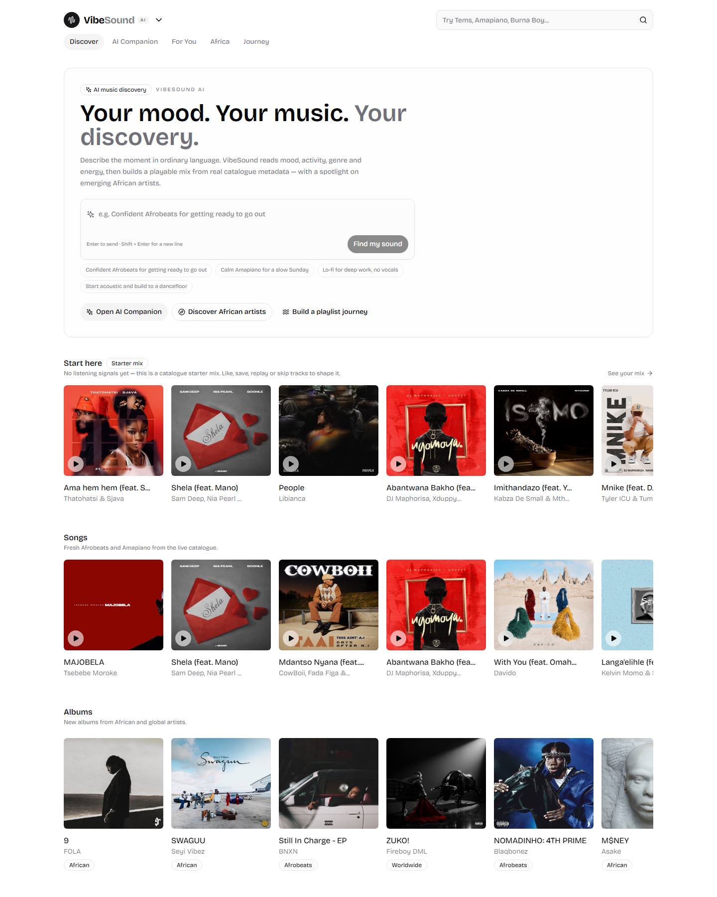
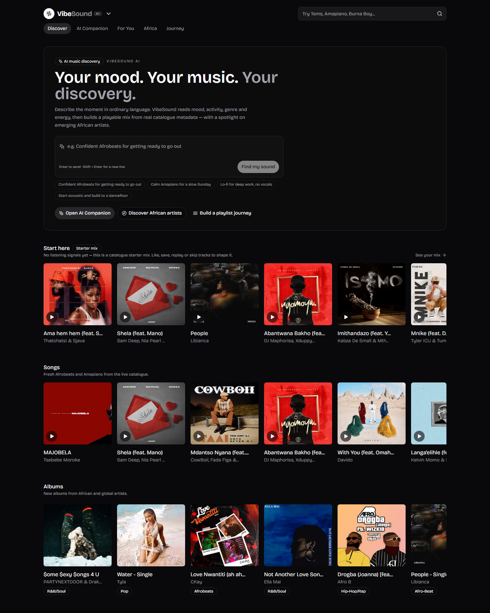
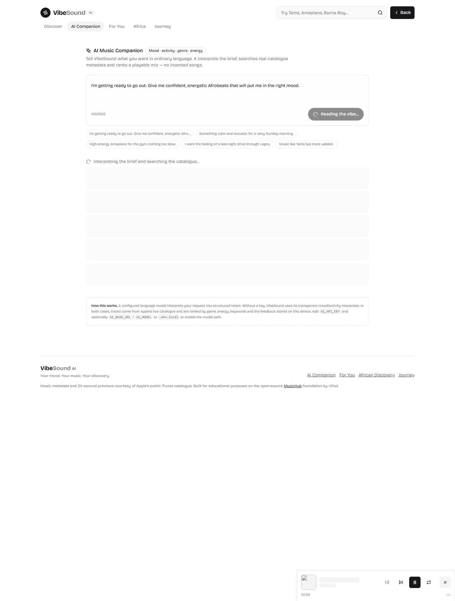
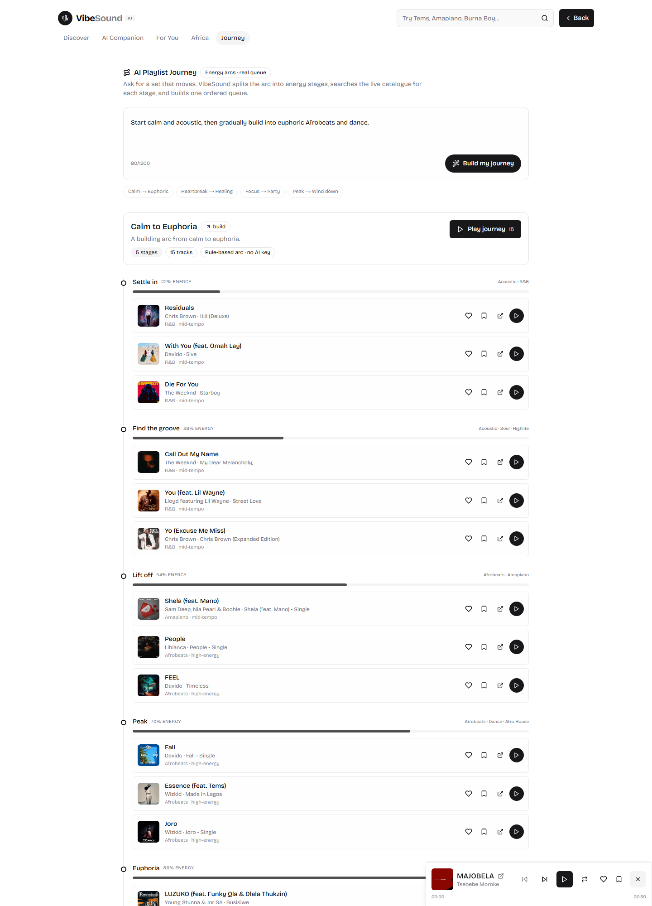
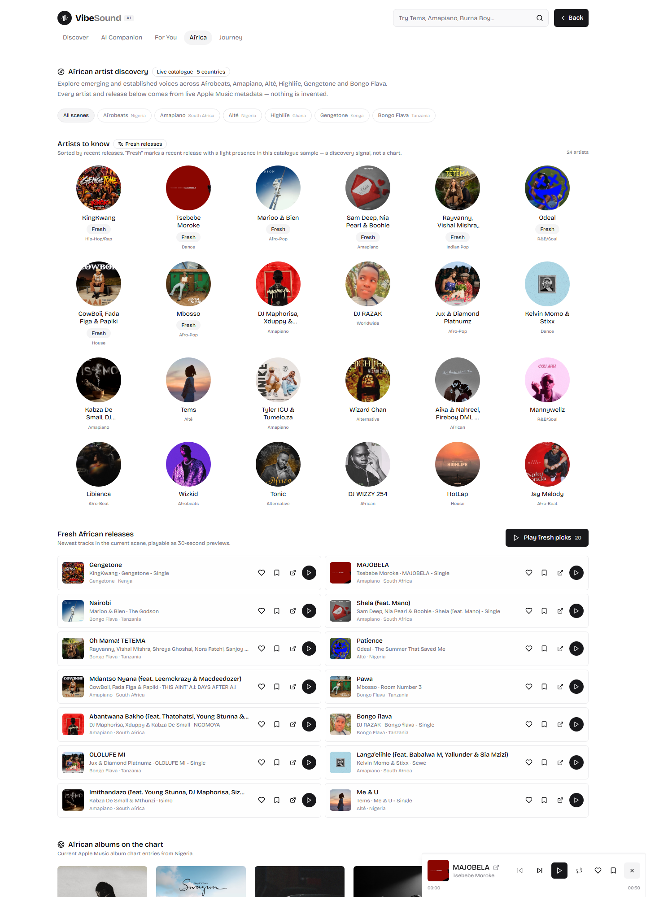
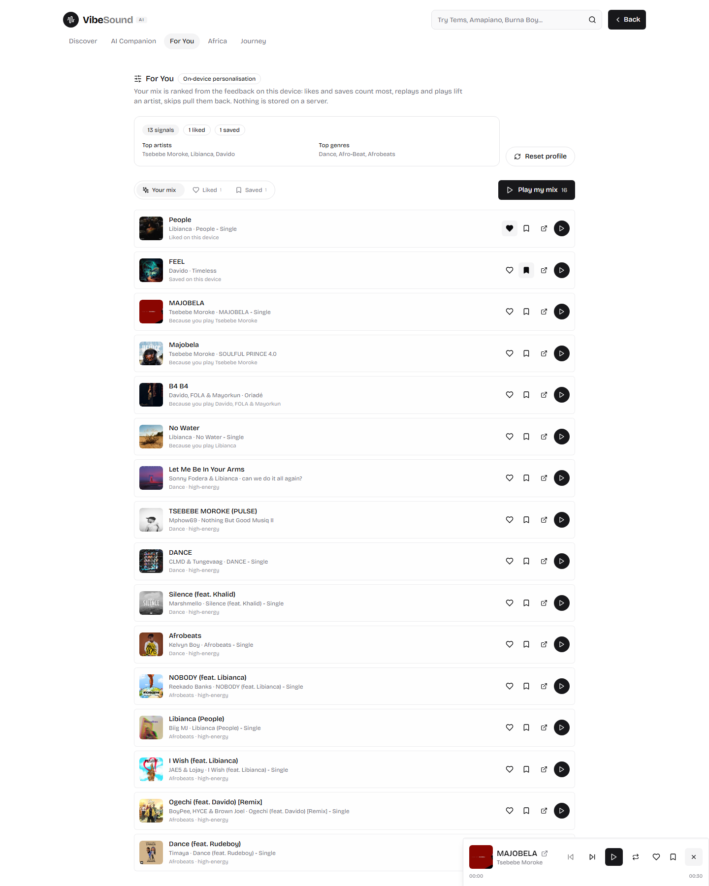
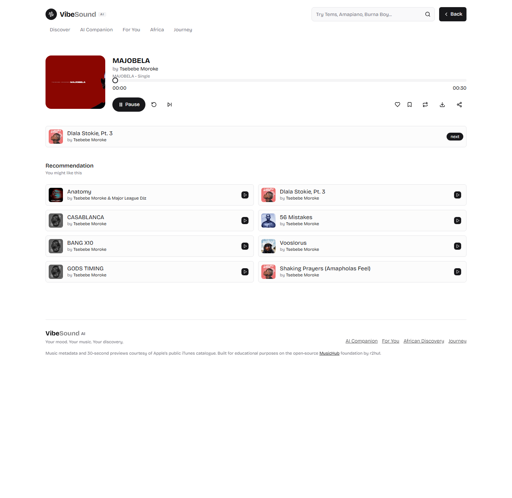
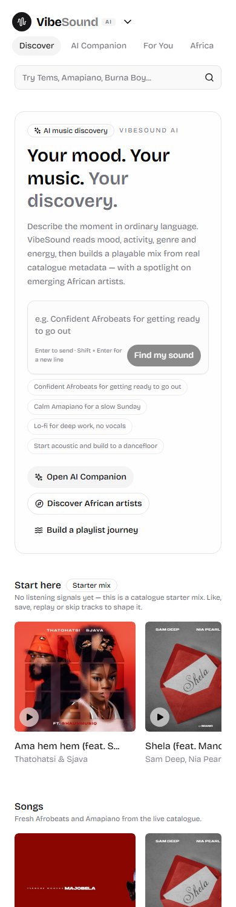

# VibeSound AI

**Your mood. Your music. Your discovery.**

VibeSound AI is an AI-powered music discovery app built on top of the open-source
[MusicHub](https://github.com/r2hu1/musichub) repository. It keeps MusicHub's
Next.js 14 App Router structure, monochrome design, cards, player and responsive
layout, then adds mood-aware discovery, on-device personalization, an African
artist discovery page and an AI playlist journey.

> **Built on:** MusicHub by [r2hu1](https://github.com/r2hu1). Original licence and
> attribution are preserved in [LICENSE](LICENSE) and in the app footer.



## What was added

| Feature | What it does | Status |
| --- | --- | --- |
| Branding | VibeSound AI name, logo, tagline, metadata, favicon, PWA manifest | Working |
| AI Music Companion | Natural-language mood/activity/genre/energy request → playable ranked mix | Working (local interpreter by default; model path configurable) |
| Personalised recommendations | Likes, saves, plays, replays and skips shape a local taste profile and the For You mix | Working, on-device |
| African artist discovery | Live Afrobeats, Amapiano, Alté, Highlife, Gengetone and Bongo Flava discovery | Working |
| AI Playlist Journey | Calm → euphoric (or reverse) arc split into energy stages, playable as one queue | Working |
| Original music features | Search, albums, artist links, track player, recommendations, download preview, theme toggle | Preserved and adapted to the new catalogue |

### Screenshots

| Page | Light | Dark |
| --- | --- | --- |
| Home |  |  |
| AI Companion |  | |
| Playlist Journey |  | |
| African Discovery |  | |
| For You |  | |
| Full player |  | |

Mobile: 

## How it works

### Music catalogue

The original project required a self-hosted JioSaavn-compatible API and threw an
error when `NEXT_PUBLIC_API_URL` was missing. VibeSound AI replaces that hard
dependency with Apple's public **iTunes Search API** and **Apple Music chart
feeds**:

- Real artist, track, album, genre, release-date and artwork metadata.
- Real **30-second preview** URLs for playback.
- No music API key required.
- Requests are normalised into the JioSaavn-like shape the existing MusicHub
  cards already use, so the original UI components keep working.
- Server-side caching (30 minutes) and a 6-second upstream timeout prevent one
  slow Apple request from hanging a page.

All requests go through `/api/music/*`; the browser never talks to the catalogue
directly.

### AI Companion

`POST /api/ai/companion` accepts `{ prompt, profile }` and:

1. Interprets the request into structured intent: genres, moods, activity,
   energy (0–1), "sounds like" artist and keywords.
2. Runs up to six catalogue searches based on that intent.
3. Filters to the requested genre when enough coherent tracks exist.
4. Ranks tracks by genre fit, energy fit, taste, freshness, keywords and artist
   match, with artist diversity.
5. Returns 12 playable tracks plus the interpretation and transparent reasons.

The interpretation has **two paths**:

- **Configured model:** any OpenAI-compatible chat-completions endpoint. The
  server asks for a JSON intent, validates it, and falls back safely if the
  provider errors.
- **No key:** the built-in lexicon/rule interpreter. The API returns
  `source: "rules"` and the UI labels it **“Local interpreter · no AI key”**.
  This path is not presented as model output.

The model only interprets the request. It never invents songs — all tracks come
from the live catalogue and deterministic ranking.

### Personalised recommendations

The taste profile lives in `localStorage` under `vibesound:taste:v1`:

- Explicit: like/unlike, save/unsave.
- Implicit: play, skip, replay, completion.
- Weighted scores per artist and genre, plus liked/saved snapshots.

`/api/music/for-you` receives a sanitised profile, searches the listener's top
artists/genres, and ranks the results. With no signals it uses a fast catalogue
starter mix. The profile is never written to a database. The UI explains that
ranking is metadata-based because Apple previews do not expose audio-feature
embeddings.

### African artist discovery

`/africa` performs live genre searches across Nigeria, South Africa, Ghana,
Kenya and Tanzania. Artist images are real release artwork; artist links use the
existing MusicHub search route. The **“Fresh”** flag means a release from the
last 18 months with a light presence in the sampled catalogue. It is explicitly
described as a discovery signal, **not a chart or an “emerging artist” claim**.

### AI Playlist Journey

`POST /api/ai/journey` parses the requested start/end moods, creates 4–6 energy
stages (model-designed when configured, rule-based otherwise), searches the
catalogue once, then fills each stage with three stage-appropriate tracks.
Named genres are placed near the matching energy point (Afrobeats lifts the
peak, not the acoustic opening). The flattened list becomes a real queue in the
shared player.

## Architecture

```
app/
  (root)/                 home, search, album, companion, africa, for-you, journey
  (player)/[id]/          full player route (preserved)
  api/ai/                 companion, journey, status
  api/music/              songs, albums, home, suggestions, africa, for-you
components/
  cards/                  original song/album/artist/player cards (adapted)
  page/                   header (with new nav), footer, logo, search
  providers/              music queue + on-device taste profile
  sections/               home prompt, personalised strip
  taste/                  like/save controls
  tracks/                 recommendation rows, play-collection button
lib/
  music/                  iTunes adapter, normalisation, genre taxonomy, cache
  ai/                     intent parser, model provider, companion, journey
  recommend/              deterministic ranking
  personalization.js      profile model, events, sanitisation
  fetch.js                client helpers for the internal music API
scripts/
  smoke-test.mjs          endpoint/page smoke test
  make_brand_assets.py    regenerates icons and OG image
```

## Running locally

Prerequisite: Node.js 18.17+ (tested with Node 24).

```bash
cd musichub-master
npm install
cp .env.example .env.local     # optional; defaults work without edits
npm run dev
```

Open [http://localhost:3000](http://localhost:3000).

Production:

```bash
npm run build
npm run start
```

There is no music API key to configure.

### AI configuration (optional)

Add to `.env.local` — **server-only, never use `NEXT_PUBLIC_` here**:

```env
AI_API_KEY=sk-...
AI_BASE_URL=https://api.openai.com/v1
AI_MODEL=gpt-4o-mini
```

Any OpenAI-compatible provider works (OpenAI, Groq's OpenAI-compatible URL,
Together, etc.). For a local model:

```env
AI_BASE_URL=http://localhost:11434/v1
AI_MODEL=llama3.1
```

No key is required for a localhost base URL. Without any of these, the app runs
the local interpreter and says so.

Optional:

```env
MUSIC_COUNTRY=US
NEXT_PUBLIC_SITE_URL=https://your-domain.example
```

## API routes

| Method | Route | Purpose |
| --- | --- | --- |
| GET | `/api/music/home` | Home sections from searches + charts |
| GET | `/api/music/songs?query=` | Track search |
| GET | `/api/music/songs/[id]` | Track details |
| GET | `/api/music/suggestions/[id]` | Related tracks |
| GET | `/api/music/albums?query=` | Album search |
| GET | `/api/music/albums/[id]` | Album + track list |
| GET | `/api/music/africa?scene=` | African discovery data |
| POST | `/api/music/for-you` | Personalised ranking |
| POST | `/api/ai/companion` | Intent + ranked mix |
| POST | `/api/ai/journey` | Arc + ordered stages |
| GET | `/api/ai/status` | Model/local mode (no secrets) |

AI routes have a small in-memory per-IP rate limit.

## Testing performed

- `next build` completes successfully with no import warnings.
- `/api/music/home` returns 16 latest tracks, 12 albums, 14 artists, 14 chart
  tracks and 10 African spotlight tracks.
- Companion request for “confident, energetic Afrobeats” returns 12 Afrobeats
  tracks with a validated interpretation.
- Journey request for “calm → euphoric Afrobeats and dance” returns 5 stages and
  15 tracks with distinct energy stages.
- Search (`tems`), album, full player, suggestions and recommendations load.
- Like/save buttons were clicked in a real browser session; the taste profile
  recorded the feedback and For You re-ranked with the liked/saved tracks first.
- Desktop, dark-mode and 390 px mobile screenshots verified (see above).
- `node scripts/smoke-test.mjs http://localhost:3000` checks the main endpoints
  and pages.

## Honest limitations / still to configure

1. **Playback is 30-second previews.** Apple's public catalogue does not provide
   full-length streaming. The original JioSaavn integration supported full
   tracks, but it required a separately deployed API and was not configured in
   the repository. Do not expect full songs here.
2. **No AI key is configured by default.** The companion and journey work, but
   use the local interpreter. Set `AI_API_KEY` (and optionally
   `AI_BASE_URL`/`AI_MODEL`) to use a real language model. The UI and API always
   disclose which path ran.
3. **Personalization is device-local.** It is real learning from feedback, but
   it does not sync across devices or survive cleared browser storage, and there
   is no account/backend. That is an architectural choice, not a hidden mock.
4. **Ranking is metadata-based.** There are no audio-feature embeddings or BPM
   data. Mood/energy priors come from genre and descriptive metadata; occasional
   mismatches (for example a downbeat song tagged Afrobeats) are possible.
5. **Catalogue coverage/availability** depends on Apple's public API and
   storefront. Some tracks/regions may be missing; failed requests degrade to
   empty sections with a message.
6. The “Fresh” African-artist flag is a transparent recency/sample heuristic,
   not a verified industry “emerging artist” ranking.

## What changed from MusicHub

- Branding, logo, metadata, favicon, manifest, header navigation and footer.
- Removed the hard `.env` requirement for `NEXT_PUBLIC_API_URL`.
- Added a server-side music catalogue adapter and API routes.
- Added AI intent parsing, optional model provider, ranking and journey logic.
- Added on-device taste profile, like/save controls and For You.
- Added African discovery and the energy-arc journey page.
- Added real queue next/previous/auto-advance and feedback to the existing player.
- Fixed the header search `router` bug, the player's destructive
  `localStorage.clear()`, hardcoded `https://` share URLs and several null-data
  crashes.
- Preserved the original cards, typography, spacing, colours and responsive
  layout.

## License

MIT — see [LICENSE](LICENSE). Music metadata and previews belong to their
respective rights holders and are provided through Apple's public catalogue.
